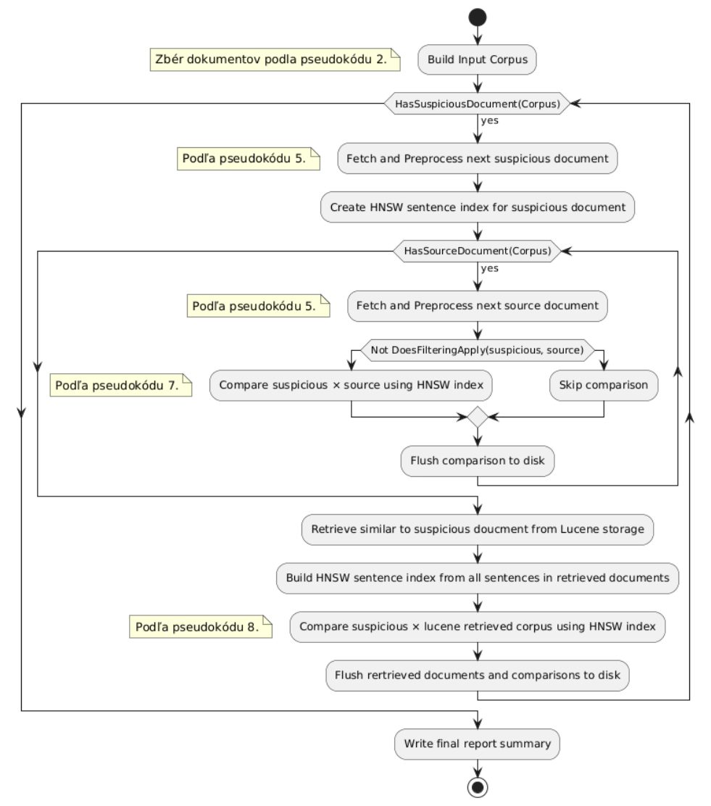

# Plagiarism Detection (Plagdet)

**Plagdet** is a Java-based tool for detecting plagiarism in technical documentation, that often
combines
natural-language descriptions with code and possibly pseudocode. It is designed for Slovak-language
documents and identifies potentially plagiarized passages rather than relying solely on
whole-document similarity scores.

## Approach
The detection pipeline compares documents at the sentence level using **word alignment and neural
word embeddings**. A **JVector HNSW index** retrieves candidate sentences for detailed comparison,
with configurable retrieval limits controlling how many candidate sentences are considered.

For reference-corpus searches, **Apache Lucene** retrieves candidate documents,
whose sentences are subsequently compared using the same general approach.
The preprocessing pipeline includes sentence splitting, morphological annotation, lemmatization,
spelling correction, and code-fragment identification.

Document metadata is also analyzed as an additional signal.

The tool supports **PDF, DOC, DOCX** (plain dirs or ZIP archives), making it suitable for analyzing
collections of student submissions.

## Evaluation highlights 

- **75.74% F1 on a manually annotated benchmark:** The best tuned configuration achieved 76.04%
  precision, 75.43% recall, and a PlagDet score of 68.58, with granularity of 1.15.

- **61% lower processing time:** 
  - With code-fragment identification enabled, analysis of 981
    documents and 480,324 document pairs took 4 h 17 min, compared with 11 h 06 min without it - 
    approximately **2.6× faster** in this experiment.
  - Reason for such "radical" approach is that, code content is tested with other system in our
  scenario, so throwing it away is acceptable.
   
- **Efficient candidate retrieval:** HNSW-based sentence search limits the candidates considered
  during alignment, avoiding exhaustive comparison of every sentence pair in the relevant search
  step. In our setup it allowed reduction of considered sentences set by 80%, preserving high 
  recall.


The annotated benchmark contained 30 documents with 33 manually annotated comparisons. The larger
981-document experiment measured corpus-scale processing performance, these are separate
evaluations.

More information about approach decision and evaluation is present in theses text, available
at [CRZP](https://opac.crzp.sk/?fn=detailBiblioForm&sid=9EB7DDC054CB7EBFE473D9EAFF98).
## Architecture
- preprocessing performed
- sentence similarity assesment based on pos and word embeddings
- tradeoff between accurracy of sentence pairing and efficiency, jvector usage
- memory constraints, removing of duplicate strings, online loading of documents and flushing on disk (consuming smallest possible amount of memory)
  - based on acitivity diagram 

## Running application
- add help output here, and jar to releases
- can contact me, to get ann dataset
- gradle version, java version

### Models installation

To download models run

```
pip install gensim
./scripts/download_models.sh
```

Default installation point in `models-tmp`.
After that copy:

- slovak-morfflex-pdt-170914-pos_only.tagger
- sk.poslemma.prim-10.0-public-saneword2vec.bin

Into resources root e.g. `plagdet-cli/resources`# Plagiarism Detection (Plagdet)

**Plagdet** is a Java-based tool for detecting plagiarism in technical documentation, that often
combines
natural-language descriptions with code and possibly pseudocode. It is designed for Slovak-language
documents and identifies potentially plagiarized passages rather than relying solely on
whole-document similarity scores.

## Approach
The detection pipeline compares documents at the sentence level using **word alignment and neural
word embeddings**. A **JVector HNSW index** retrieves candidate sentences for detailed comparison,
with configurable retrieval limits controlling how many candidate sentences are considered.

For reference-corpus searches, **Apache Lucene** retrieves candidate documents,
whose sentences are subsequently compared using the same general approach.
The preprocessing pipeline includes sentence splitting, morphological annotation, lemmatization,
spelling correction, and code-fragment identification.

Document metadata is also analyzed as an additional signal.

The tool supports **PDF, DOC, DOCX** (plain dirs or ZIP archives), making it suitable for analyzing
collections of student submissions.

## Evaluation highlights 

- **75.74% F1 on a manually annotated benchmark:** The best tuned configuration achieved 76.04%
  precision, 75.43% recall, and a PlagDet score of 68.58, with granularity of 1.15.

- **61% lower processing time:** 
  - With code-fragment identification enabled, analysis of 981
    documents and 480,324 document pairs took 4 h 17 min, compared with 11 h 06 min without it - 
    approximately **2.6× faster** in this experiment.
  - Reason for such "radical" approach is that, code content is tested with other system in our
  scenario, so throwing it away is acceptable.
   
- **Efficient candidate retrieval:** HNSW-based sentence search limits the candidates considered
  during alignment, avoiding exhaustive comparison of every sentence pair in the relevant search
  step. In our setup it allowed reduction of considered sentences set by 80%, preserving high 
  recall.


The annotated benchmark contained 30 documents with 33 manually annotated comparisons. The larger
981-document experiment measured corpus-scale processing performance, these are separate
evaluations.

## Further reading

For a detailed discussion of the design decisions, implementation, and evaluation, see the
at [original thesis in the Slovak Central Register of Theses (CRZP)](https://opac.crzp.sk/?fn=detailBiblioForm&sid=9EB7DDC054CB7EBFE473D9EAFF98).

## Architecture
- preprocessing performed
- sentence similarity assesment based on pos and word embeddings
- tradeoff between accurracy of sentence pairing and efficiency, jvector usage
- memory constraints, removing of duplicate strings, online loading of documents and flushing on disk (consuming smallest possible amount of memory)
  - based on acitivity diagram 

## Running application
- add help output here, and jar to releases, usage, ui
- can contact me, to get ann dataset
- gradle version, java version

### Models installation

To download models run

```
pip install gensim
./scripts/download_models.sh
```

Default installation point in `models-tmp`.
After that copy:

- slovak-morfflex-pdt-170914-pos_only.tagger
- sk.poslemma.prim-10.0-public-saneword2vec.bin

Into resources root e.g. `plagdet-cli/resources`


