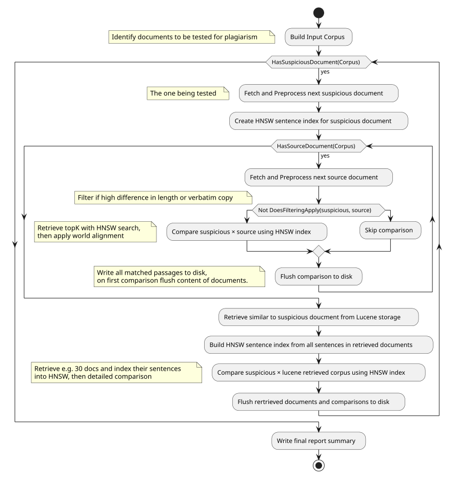

# Plagiarism Detection (Plagdet)

**Plagdet** is a Java-based tool for detecting plagiarism in technical documentation, that often
combines
natural-language descriptions with code and possibly pseudocode. It is designed for Slovak-language
documents and identifies potentially plagiarized passages rather than relying solely on
whole-document similarity scores.

---
The detection pipeline compares documents at the sentence level using **word alignment and neural
word embeddings**. A **JVector HNSW index** retrieves candidate sentences for detailed comparison,
with configurable retrieval limits controlling how many candidate sentences are considered.

For reference-corpus searches, **Apache Lucene** retrieves candidate documents,
whose sentences are subsequently compared using the same general approach.

The preprocessing pipeline includes sentence splitting, morphological annotation, lemmatization,
spelling correction, and code-fragment identification. Document metadata is also analyzed as an
additional signal.

The tool supports **PDF, DOC, DOCX** documents, including collections organized in directories or
ZIP archives.

More information about approach decision and evaluation is present in theses text, available
at [CRZP](https://opac.crzp.sk/?fn=detailBiblioForm&sid=9EB7DDC054CB7EBFE473D9EAFF98).

## Evaluation highlights

- **75.74% F1 on a manually annotated benchmark:**
    - The best tuned configuration achieved 76.04%
      precision, 75.43% recall, and a PlagDet score of 68.58, with granularity of 1.15 (about
      metrics see [PAN](https://pan.webis.de/)).

- **61% lower processing time:**
    - With code-fragment identification enabled, analysis of 981
      documents and 480,324 document pairs took 4 h 17 min, compared with 11 h 06 min without it -
      approximately **2.6× faster** in this experiment.
    - In the target scenario, source code is analyzed by a separate detection
      system. Code fragments are therefore excluded from the natural-language
      comparison pipeline, avoiding unnecessary processing and sentence
      fragmentation while making text-based similarity results more relevant.

- **Efficient candidate retrieval:**
    - HNSW-based sentence search limits the candidates considered
      during sentence alignment, avoiding exhaustive comparison of every sentence pair.
      In our setup it allowed reduction of considered sentences set by 80%, preserving high
      recall.

The annotated benchmark contained 30 documents with 33 manually annotated comparisons. The larger
981-document experiment measured corpus-scale processing performance, these are separate
evaluations.

## Approach

This section extends previous overview with additional notes on preprocessing and comparison,
for formal specification see full text of the work.

### Preprocessing

Preprocessing pipeline can be summarized by pseudocode below:

```
Preprocess(text):
    tokens ← Tokenize(text)
    lines ← SplitIntoLines(tokens)
    classified ← ClassifyCode(lines)
    paragraphs ← GroupNaturalLanguageLines(classified)
    sentences ← SplitAtPunctuation(paragraphs)

    for each sentence:
        if tokenCount(sentence) > 15:
            clauses ← SplitIntoClauses(sentence)
            sentence ← MergeToMinimumLength(clauses, 5)

    for each sentence:
        tokens ← MorphologicalAnalysis(sentence)
        tokens ← PreserveWords(tokens)
        tokens ← RemoveShortWords(tokens)
        tokens ← RemoveStopwords(tokens)

        if tokenCount(tokens) < 2:
            Drop(sentence)

        tokens ← CorrectSpelling(tokens)
        tokens ← MorphologicalAnalysis(tokens)

    RemoveTemplateText(text, TemplateText)
```

Notable preprocessing steps include:

- code classification
- sentence length balancing by splitting based on clause and merging
- spell checking
- template text removal (e.g task definition)

### Sentence comparison

Document comparison follows three stages:

1. **Seed:**
    - Candidate sentence matches are identified using bidirectional word alignment
        - Best matching word identified via cosine similarity over word2vec embeddings
    - Each word impact over sentence similarity score is derived from word's cosine similarity
      weighted by their
        - POS coefficient: e.g. matched adjectives are more important,
        - corpus IDF: e.g. word "process" (OS term), is of none importance when matched, in context
          of OS university course assignment.

2. **Extend:**
    - Nearby matches are recursively combined into larger matching fragments,
      allowing for gaps and inserted or omitted sentences.
3. **Filter:**
    - Short and overlapping fragments are removed to produce the final matches.

To avoid exhaustive sentence to sentence comparison, sentences are first represented as weighted
sums
of their word embeddings, using the same POS $\times$ IDF weights. A **JVector HNSW index**
retrieves candidate sentences for detailed comparison. In the evaluated configuration,
the retrieval limit was set to 20% of the indexed sentence set.

For reference-corpus searches, **Apache Lucene** first retrieves potentially relevant documents.
Their sentences are then indexed and compared using the same approach.

### Implementation constraints

The application was designed for a shared VM with limited available memory and a
900-second execution limit for unprivileged processes.
Memory profiling with **Java Mission Control and Java Flight Recorder** helped identify
expensive object retention and duplicated text representations in the NLP pipeline.

To reduce peak memory usage, the implementation minimizes redundant strings, loads documents
incrementally, and flushes comparison results to disk as soon as they are produced, rather than
keeping the entire comparison workload in memory.

The overall processing flow is illustrated below.



## Running the application

### Requirements

- Linux (the current native MorphoDiTa dependency is Linux-specific)
- Java 17 or later
- Gradle 8.10.1 (the included Gradle Wrapper can be used)

The project uses the native MorphoDiTa library located in `libs/`. When running the application, provide this directory as the native library path:

```bash
-Djava.library.path=./libs
```

### Building
To build application first install language models via:

```bash
python -m pip install gensim
./scripts/download_models.sh
```

By default, the models are prepared in `models-tmp/`. Copy the following files into the CLI 
resources directory  `plagdet-cli/src/main/resources/`:

- `slovak-morfflex-pdt-170914-pos_only.tagger`
- `sk.poslemma.prim-10.0-public-saneword2vec.bin`


Then build the executable JAR using the Gradle Wrapper:

```bash
./gradlew :plagdet-cli:shadowJar
```

The resulting JAR is accessible via path:
```
./plagdet-cli/build/libs/plagdet-cli.jar
```

Prebuilt JAR file also available in [GitHub Releases](https://github.com/TarasHamkalo/plagiarism-detection/releases).

### Running a comparison

To analyze a collection of documents:

```bash
java -Dsystem.library.path=./libs \
    -jar dist/plagdet-cli.jar \
    -n ./submissions \
    -o ./report.zip
```

The input (`-n`) can be a supported document, directory, or ZIP archive. Nested ZIP archives (e.g. multiple submissions per single student)
are also supported.

The output is a ZIP archive containing the analysis results, document contents, metadata, and detected matches. The default output filename is `report.zip`.
You can analyze it through [Plagdet UI](https://tarashamkalo.github.io/plagdet-ui/) at github.io. 
### Indexing a reference corpus
 
Plagdet supports building a persistent Lucene index of reference submissions. 
This allows subsequent analyses to retrieve potentially relevant source
documents without using extensive, pair wise comparison with each.

First, index the reference collection:

```bash
java -Dsystem.library.path=./libs \
    -jar dist/plagdet-cli.jar \
    -n ./reference-submissions \
    -i \
    -l ./lucene-index
```

Then analyze new submissions against the existing index:

```bash
java -Dsystem.library.path=./libs \
    -jar dist/plagdet-cli.jar \
    -n ./new-submissions \
    -l ./lucene-index \
    -o ./report.zip
```

The `-i` option creates an index without performing document comparisons. The `-l` option specifies the index directory. 

### Configuration

The CLI provides options for adjusting similarity thresholds, sentence retrieval limits, document filtering, fragment merging, metadata analysis, and other parts of the detection pipeline.

Use the built-in help to see all available options and their defaults:

```bash
java -Dsystem.library.path=./libs \
    -jar dist/plagdet-cli.jar \
    -h
```
Output:
```txt
usage: java -jar plagdet.jar
 -alignment-th <arg>                    Drop every sentence match below
                                        that similarity by Word alignment
                                        score. Default [0.75]
 -bypass-code-removal                   Flag to stop removing code
                                        segments from documents Default
                                        [false]
 -bypass-length-filter                  Flag to continue comparison after
                                        size ratio wasn't matched. Default
                                        [false]
 -bypass-results-filter                 Flag to store all results produced
                                        during comparison Default [false]
 -bypass-shingle-filter                 Flag to continue comparison after
                                        shingle overlap threshold reached.
                                        Default [false]
 -bypass-spellcheck                     Flag to stop executing spell
                                        checking Default [false]
 -bypass-template-removal               Flag to stop removing template
                                        document matches from [new-path]
                                        document collection. Default
                                        [false]
 -discard-level <arg>                   Threshold for Jaccard similarity,
                                        document pairs below that
                                        threshold will be considered as
                                        plagiarism free. Default [0.1]
 -document-size-ratio-th                Document pairs for which size
                                        ratio is lower than specified
                                        value, won't be compared Default
                                        [0.3]
 -enable-metadata-filter                Flag to stop comparison after
                                        matching authors/modifier Default
                                        [true]
 -h                                     Print help information
 -i                                     Flag to index submissions without
                                        comparison Default [false]
 -l,--lucene-path <arg>                 Path to the lucene index
                                        directory, if empty, then
                                        temporary directory created
 -max-gap <arg>                         Gap between two matches which is
                                        acceptable during match merging.
                                        Default [2]
 -max-meta-docs <arg>                   Amount of queried documents per
                                        filed with same metadata Default
                                        [3]
 -max-results <arg>                     Maximum number of comparisons per
                                        document to be stored in report.
                                        Default [20]
 -max-sim-docs <arg>                    Amount of content queried
                                        documents Default [20]
 -min-char-len <arg>                    Minimum character length for
                                        fragment to be preserved as
                                        plagiarism case. Default [90]
 -min-fragment-sim <arg>                Min similarity for a group of
                                        sentence to be considered as
                                        similar, otherwise group is
                                        resplit. Default [0.9]
 -min-fragment-size <arg>               Minimum number of sentence to be
                                        considered as plagiarism. Default
                                        [5]
 -min-result-sim <arg>                  Minimum similarity for comparison
                                        to be recorded. Default [0.5]
 -min-sentences-th <arg>                Represents the least amount of top
                                        sentences to query for during
                                        Index search. The higher value the
                                        more sentences suspicious sentence
                                        is compared to, eliminating false
                                        negatives during lookup stage.
                                        Default [4]
 -n,--new-path <arg>                    Path to the new submissions
                                        zip/directory
 -o,--output-path <arg>                 Path to report file, to which
                                        report data will be written
                                        Default [report.zip]
 -plagiarized-level <arg>               Threshold for Jaccard similarity,
                                        over which two are considered
                                        plagiarized. Default [0.8]
 -sentence-size-ratio-th <arg>          Drop every sentence match below
                                        that size ratio min(len1 / len2,
                                        len2 / len1). Default [0.5]
 -sentences-per-document-th <arg>       Represents default per document
                                        count of top sentences to query
                                        fore.g. having 10 documents in
                                        corpus and th=5, for each sentence
                                        will be queried 10 * 5 top
                                        sentences from index. Default [5]
 -sentences-percentage-multi-th <arg>   Represents the hard limit in
                                        percentage of total sentences for
                                        count of top sentences to query
                                        for, when doing document to corpus
                                        match. Default [0.1]
 -sentences-percentage-th <arg>         Percentage of the number of source
                                        document sentences that will be
                                        considered during index search.
                                        Default [0.2]
 -shingle-overlap <arg>                 Shingle overlap. Default [1]
 -shingle-size <arg>                    Shingle size. Default [2]
 -t,--template-path <arg>               Path to the template file Default
                                        [IPC task description]
 -vector-sim-th <arg>                   Query HNSW sentence index for top
                                        K sentences above that threshold.
                                        Default [0.65]
```

## User interface

The Angular-based interface is maintained in a [separate repository](https://github.com/TarasHamkalo/plagdet-ui),
you can access it via github.io pages at [Plagdet UI](https://tarashamkalo.github.io/plagdet-ui/).

To inspect an analysis, generate a report ZIP using the CLI and
import it through the UI's **Import analysis** page. The interface provides
document comparisons, navigation between matching fragments,
metadata inspection, a similarity heatmap, and a graph for exploring
groups of similar submissions.

See the UI repository for its build and deployment instructions.

## Project documentation

The repository also includes the thesis appendices with more extensive 
user and system documentation.

The system documentation contains **UML class diagrams**,
module and package descriptions, dependency information,
and implementation details. It also describes important
extension points, such as adding document readers and extending preprocessing
or indexing functionality.

See [the project appendices](docs/system-appendix-and-manual.pdf) for the complete documentation.